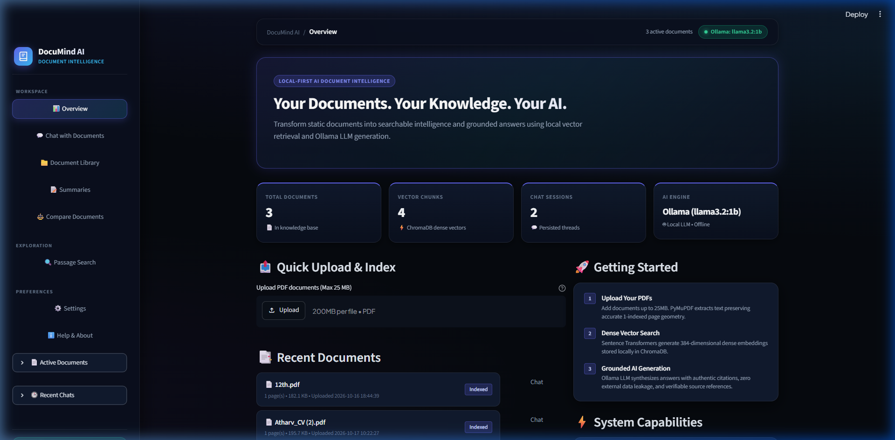
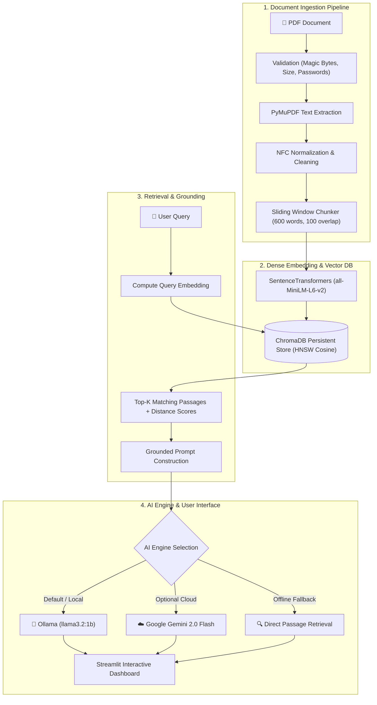

# DocuMind AI

<div align="center">

<h3>"Your Documents. Your Knowledge. Your AI."</h3>

<p>A local-first, privacy-preserving AI document intelligence platform that transforms static PDFs into searchable semantic knowledge and grounded answers using dense vector retrieval and local LLM generation.</p>

[](https://www.python.org/)
[](https://streamlit.io/)
[](https://ollama.com/)
[](https://www.trychroma.com/)
[](https://huggingface.co/sentence-transformers/all-MiniLM-L6-v2)
[](LICENSE)

</div>

<div align="center">
  
</div>

---

## 📌 Project Overview & Problem Statement

Knowledge workers, researchers, legal analysts, and engineers routinely navigate massive, unstructured PDF documents—financial filings, technical manuals, research publications, and policy agreements. Traditional keyword search (`Ctrl+F`) lacks semantic comprehension, cannot answer multi-part questions, and cannot synthesize concepts across multiple pages. Conversely, uploading proprietary or personal documents to public cloud AI APIs introduces severe privacy risks, confidentiality breaches, and recurring cloud costs.

**DocuMind AI** solves this problem by delivering a **local-first Retrieval-Augmented Generation (RAG)** workspace:
- **100% Data Locality**: Document parsing, text chunking, dense vector embeddings, and LLM text generation can run completely on your local workstation without external cloud transmission.
- **Strict Anti-Hallucination Grounding**: Formatted prompts instruct the generative engine to synthesize responses exclusively from retrieved source passages.
- **Verifiable Citations**: Every generated answer is accompanied by exact document filenames, 1-indexed page numbers, chunk identifiers, and similarity distance scores.
- **Multi-Provider Flexibility**: Operate completely offline with local **Ollama (`llama3.2:1b`)**, switch optionally to **Google Gemini Cloud**, or use **Passage Retrieval Only** mode without any LLM requirement.

---

## 🏗️ System Architecture



---

## ⚙️ How It Works (The 7-Stage RAG Pipeline)

1. **Ingestion & Validation**: Incoming files are checked for valid `%PDF` magic bytes, unencrypted status, and a 25 MB file size limit. PyMuPDF (`fitz`) extracts clean text page-by-page while maintaining 1-indexed page geometry.
2. **Text Normalization**: Extracted text undergoes NFC Unicode normalization, stripping non-printable control characters and collapsing excessive whitespace to prevent indexing anomalies.
3. **Sliding-Window Chunking**: Documents are split into configurable semantic segments (default: 600 words) with sliding-window overlap (default: 100 words), ensuring context preservation across page boundaries.
4. **Dense Vector Embeddings**: Each text chunk is converted into a 384-dimensional dense vector using Hugging Face's `sentence-transformers/all-MiniLM-L6-v2`. Embeddings are normalized for cosine distance calculations.
5. **Persistent Vector Storage**: Vectors, text passages, and structured metadata (document ID, filename, page number, chunk index) are indexed in local ChromaDB collections using Hierarchical Navigable Small World (HNSW) graphs.
6. **Semantic Similarity Retrieval**: User questions are embedded in real time. ChromaDB performs vector similarity search to return the top-$K$ most relevant passages along with cosine distance metrics.
7. **Grounded Generation & Citations**: The retrieved passages are formatted into a grounded prompt. The configured LLM (Ollama `llama3.2:1b` or Gemini) generates an answer strictly based on the provided text, accompanied by clickable source citation cards.

---

## 🚀 Key Features

- **Document Ingestion & Validation**: Fast, memory-safe text extraction using `PyMuPDF` with 1-indexed page geometry, file size limits (up to 25 MB), and `%PDF` magic byte verification.
- **SHA-256 Deduplication**: Computes cryptographic hashes of incoming files to prevent redundant embeddings and preserve vector store integrity.
- **Dense Vector Search**: Generates 384-dimensional normalized vector embeddings using Hugging Face's `sentence-transformers/all-MiniLM-L6-v2`.
- **Persistent ChromaDB**: Persistent local vector storage using HNSW graphs with cosine distance metrics.
- **Ollama Local LLM Generation**: Native integration with local Ollama (`llama3.2:1b` or any installed model) for private question answering.
- **Hybrid AI Engine**: Seamlessly switch between Ollama (100% offline), Google Gemini (Cloud API), or Direct Passage Retrieval mode in Settings.
- **Authentic Citations**: Interactive citation cards displaying document name, exact page number, chunk index, and relevance similarity percentage.
- **Executive Summaries**: Generate structured briefs, key findings, and action items from indexed documents.
- **Cross-Document Comparison**: Compare multiple documents simultaneously to identify differences, overlaps, and unique takeaways.
- **Passage Search Explorer**: Direct semantic vector search tool to query indexed chunks without invoking an LLM.
- **Dark-AI Dashboard**: Custom-styled Streamlit interface with midnight navy surfaces, electric cyan accents, and responsive KPI metrics.

---

## 🛠️ Verified Technology Stack

| Layer | Technology | Version | Purpose |
| :--- | :--- | :--- | :--- |
| **Language** | Python | `3.13.1` | Core execution environment |
| **UI Framework** | Streamlit | `^1.40.0` | Reactive SaaS-style interface |
| **Local LLM Engine** | Ollama | `^0.4.0` | Local language model inference (`llama3.2:1b`) |
| **Cloud LLM (Optional)** | Google GenAI SDK | `^1.0.0` | Gemini 2.0 Flash integration |
| **PDF Extraction** | PyMuPDF (`fitz`) | `^1.25.3` | High-fidelity text and page parsing |
| **Embeddings** | Sentence Transformers | `^3.3.1` | `all-MiniLM-L6-v2` (384-dim dense vectors) |
| **Vector Database** | ChromaDB | `^0.5.23` | Persistent HNSW cosine vector index |
| **Environment** | python-dotenv | `^1.0.1` | Local configuration management |
| **Testing** | Pytest | `^8.3.3` | Unit, integration, and pipeline test suite |

---

## 📋 Prerequisites

Before installing DocuMind AI, ensure your system has:

1. **Python 3.13+** installed and available in your PATH.
2. **Ollama** installed on your workstation:
   - Download from [ollama.com](https://ollama.com/download)
   - Start the Ollama application or service (runs at `http://localhost:11434`)
   - Pull the recommended lightweight model:
     ```powershell
     ollama pull llama3.2:1b
     ```

---

## 💻 Installation & Setup (Windows PowerShell)

### 1. Clone the Repository
```powershell
git clone https://github.com/Atharv428/DocuMind-AI.git
cd DocuMind-AI
```

### 2. Set Up Virtual Environment
```powershell
py -3.13 -m venv .venv
.\.venv\Scripts\Activate.ps1
```

### 3. Install Dependencies
```powershell
python -m pip install --upgrade pip
python -m pip install -r requirements.txt
```

### 4. Configure Environment
Copy the example configuration to `.env`:
```powershell
Copy-Item .env.example .env
```

Your `.env` file comes preconfigured with local-first defaults:
```env
LLM_PROVIDER=ollama
OLLAMA_BASE_URL=http://localhost:11434
OLLAMA_MODEL=llama3.2:1b
OLLAMA_TIMEOUT=60
EMBEDDING_MODEL=sentence-transformers/all-MiniLM-L6-v2
CHROMA_PATH=./data/chroma
UPLOADS_PATH=./data/uploads
TOP_K=4
CHUNK_SIZE=600
CHUNK_OVERLAP=100
TEMPERATURE=0.2
MAX_FILE_SIZE_MB=25
```

*(Optional)* If you wish to use Google Gemini instead of Ollama, add your key to `.env`:
```env
GEMINI_API_KEY=your_gemini_api_key_here
GEMINI_MODEL=gemini-2.0-flash
```

---

## ⚡ Running the Application

Launch the Streamlit dashboard:

```powershell
streamlit run app.py
```

The application will launch in your browser at:
```text
http://localhost:8501
```

---

## 🔧 Configuration & Troubleshooting

### Ollama Connectivity
- **Symptom**: Top status badge displays `Ollama Offline`.
- **Fix**: Verify that the Ollama service is running by visiting `http://localhost:11434` in your browser. Start Ollama from your Start menu or run `ollama serve` in a terminal.
- **Model Check**: Run `ollama list` to confirm `llama3.2:1b` is installed. If missing, run `ollama pull llama3.2:1b`.

### Port Conflicts (`Port 8501 is not available`)
- If port 8501 is occupied by another process, run Streamlit on an alternate port:
  ```powershell
  streamlit run app.py --server.port 8502
  ```

### ChromaDB Migration or Lock Issues
- ChromaDB stores persistent SQLite and index data in `./data/chroma`.
- If an unexpected lock occurs after a system crash, ensure all running Python instances are terminated before restarting.

---

## 📂 Project Structure

```text
DocuMind-AI/
├── app.py                      # Streamlit application dashboard & view orchestrator
├── requirements.txt            # Project dependencies
├── pytest.ini                  # Pytest configuration
├── .env.example                # Template configuration with local-first defaults
├── .gitignore                  # Git privacy & hygiene rules
├── README.md                   # Comprehensive project documentation
├── CONTRIBUTING.md             # Open-source contribution guidelines
├── SECURITY.md                 # Security policy & responsible disclosure
├── LICENSE                     # MIT License
├── assets/                     # Authentic application screenshots & graphics
│   └── dashboard.png           # High-resolution dashboard screenshot
├── .github/                    # GitHub community health templates
│   ├── ISSUE_TEMPLATE/
│   │   ├── bug_report.md       # Standardized bug reporting form
│   │   └── feature_request.md  # Feature suggestion template
│   └── pull_request_template.md# Pull request validation checklist
├── rag/                        # RAG pipeline modules
│   ├── __init__.py             # Package exports
│   ├── config.py               # Settings dataclass & environment loaders
│   ├── document_loader.py      # PDF validation, PyMuPDF extraction, normalization
│   ├── chunker.py              # Word sliding-window chunker with overlap
│   ├── embeddings.py           # SentenceTransformer dense embeddings
│   ├── vector_store.py         # ChromaDB PersistentClient & HNSW indexing
│   ├── retriever.py            # Cosine semantic similarity search
│   ├── generator.py            # Ollama & Gemini generators with Unified fallback
│   └── pipeline.py             # End-to-end RAG orchestrator
├── services/                   # Business state & persistence services
│   ├── __init__.py
│   ├── document_service.py     # Document metadata registry (data/documents.json)
│   └── chat_service.py         # Thread session & message history manager
├── ui/                         # Presentation & component library
│   ├── __init__.py
│   ├── styles.py               # Custom CSS design system (midnight navy & cyan)
│   └── components.py           # Reusable KPI cards, source cards, navigation
├── tests/                      # Automated test suite (21 tests)
│   ├── test_chunker.py
│   ├── test_document_loader.py
│   ├── test_features_workflow.py
│   ├── test_local_rag.py
│   ├── test_ollama_generator.py
│   ├── test_pipeline.py
│   └── test_retriever.py
└── data/                       # Local storage (git-ignored for privacy)
    ├── uploads/                # Local uploaded PDF documents (.gitkeep tracked)
    └── chroma/                 # Persistent ChromaDB vector indices (.gitkeep tracked)
```

---

## 🔒 Privacy & Security Considerations

- **Zero External Telemetry**: In Ollama mode, your documents, chunk embeddings, and prompts remain strictly on your local machine.
- **Key Sanitization**: Any configured API credentials (e.g. `GEMINI_API_KEY`) are dynamically masked as `[API_KEY_HIDDEN]` across all exception messages, logs, and UI errors.
- **Sanitized Git Tracking**: The `.gitignore` prevents private user documents, ChromaDB databases, `.env` secrets, and session histories from ever being committed to source control.
- **Full Data Purge**: Deleting a document from the Document Library removes both the physical file and all associated embeddings from the ChromaDB vector database.

---

## 🧪 Testing & Verification

DocuMind AI includes an automated test suite verifying document ingestion, chunking, vector filtering, Ollama prompt construction, API error sanitization, and fallback behavior.

Run the test suite with:

```powershell
python -m pytest
```

Expected output:
```text
============================= test session starts =============================
platform win32 -- Python 3.13.1, pytest-9.1.1, pluggy-1.7.0
rootdir: D:\RAG\DocuMind-AI
configfile: pytest.ini
collected 21 items

tests\test_chunker.py ..                                                 [  9%]
tests\test_document_loader.py .                                          [ 14%]
tests\test_features_workflow.py ......                                   [ 42%]
tests\test_local_rag.py ....                                             [ 61%]
tests\test_ollama_generator.py ......                                    [ 90%]
tests\test_pipeline.py .                                                 [ 95%]
tests\test_retriever.py .                                                [100%]

============================= 21 passed in 25.36s =============================
```

---

## ⚠️ Known Limitations

1. **Scanned Documents (OCR)**: Ingestion requires documents with selectable text. Scanned PDFs (pure images) will be rejected with an informative notice; integration with Tesseract OCR is planned for a future update.
2. **Single-User Architecture**: Built as a responsive desktop-first dashboard for individuals and researchers; multi-tenant role-based access control (RBAC) is intentionally deferred.
3. **Hardware Requirements**: Local LLM generation with Ollama benefits from 8 GB+ RAM and modern CPU/GPU cores.

---

## 🗺️ Project Roadmap

- [x] Local-first RAG pipeline with PyMuPDF, SentenceTransformers, and ChromaDB
- [x] Native Ollama integration (`llama3.2:1b`) with automated reachability checking
- [x] Multi-provider fallback (Ollama local, Gemini cloud, offline passage retrieval)
- [x] Citation tracking with 1-indexed page metadata and cosine distance scores
- [x] Executive summarization and cross-document comparative analysis
- [x] Midnight navy & electric cyan UI redesign with KPI stat cards
- [x] Full automated test suite (21 tests covering ingestion, vector store, and generation)
- [x] Open-source contribution framework (`CONTRIBUTING.md`, `SECURITY.md`, issue/PR templates)
- [ ] OCR support for scanned documents using Tesseract / PaddleOCR
- [ ] Support for additional document types (`.docx`, `.txt`, `.md`, `.epub`)
- [ ] Streaming response support in the chat view

---

## 🤝 Contributing

Contributions are warmly welcome! Whether you are fixing bugs, optimizing prompts, adding document loaders, or improving documentation, please read our [CONTRIBUTING.md](CONTRIBUTING.md) guide before opening a pull request.

Please review our [SECURITY.md](SECURITY.md) for information on reporting security vulnerabilities.

---

## 👤 Author

**Atharv Kiran Nawale**
- GitHub: [@Atharv428](https://github.com/Atharv428)
- Project Repository: [https://github.com/Atharv428/DocuMind-AI](https://github.com/Atharv428/DocuMind-AI)

---

## 📄 License

This project is licensed under the MIT License — see the [LICENSE](LICENSE) file for details.

---

<div align="center">
  <sub>Built with ❤️ by <a href="https://github.com/Atharv428">Atharv Kiran Nawale</a> using Streamlit, Ollama, and ChromaDB.</sub><br>
  <sub>If you find DocuMind AI useful, please consider giving it a ⭐ on GitHub!</sub>
</div>
